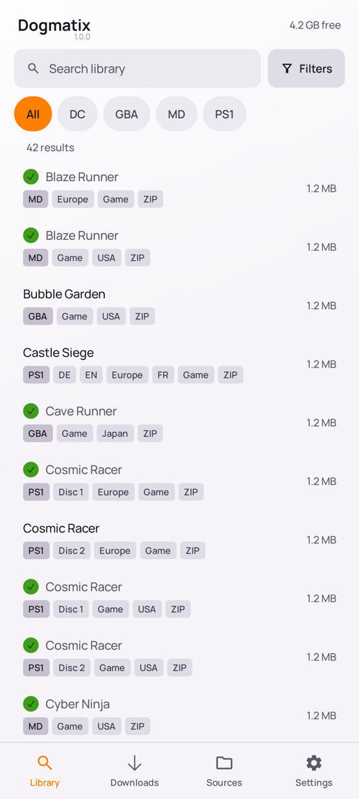
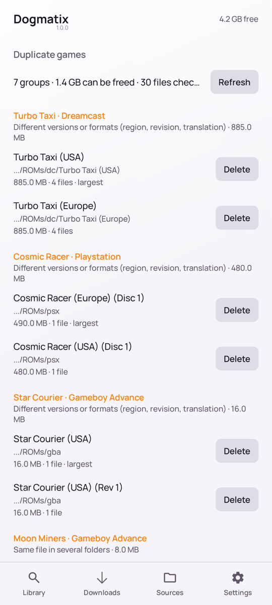
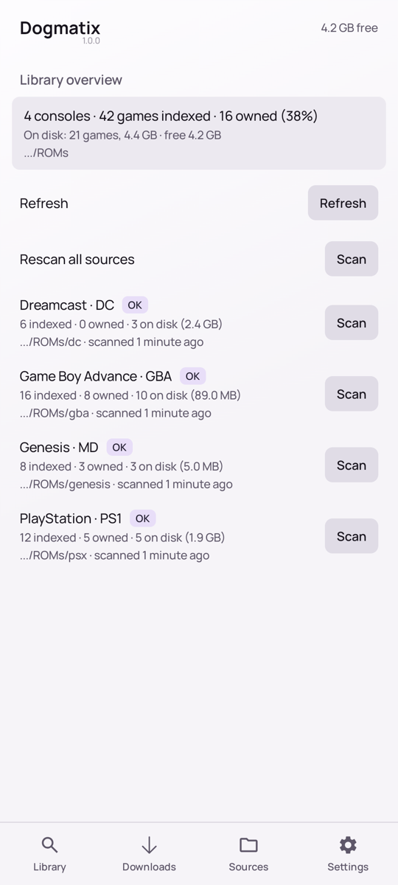
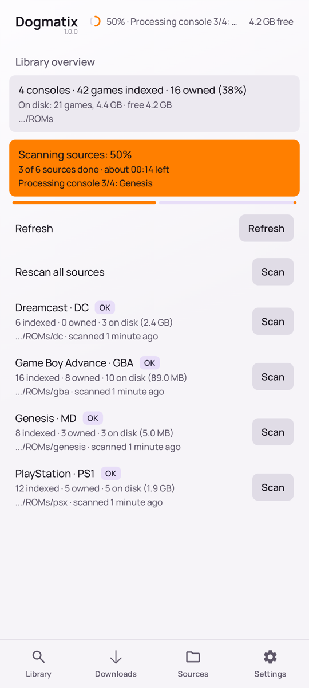
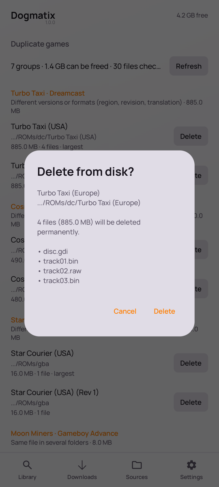
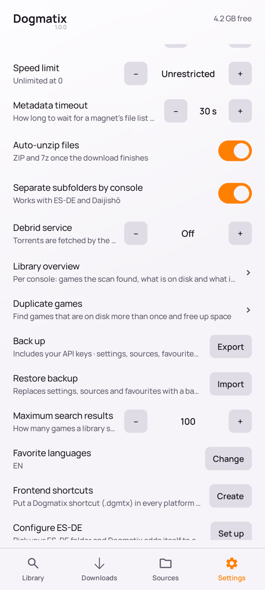
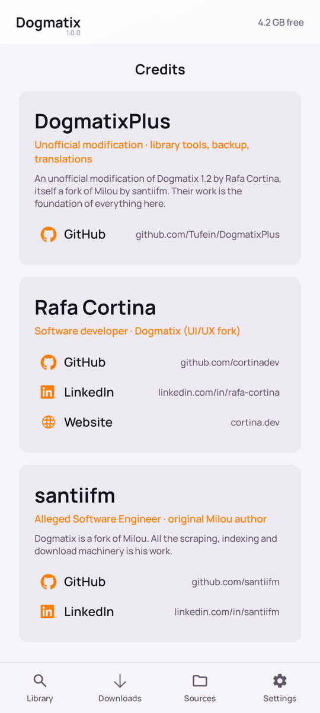
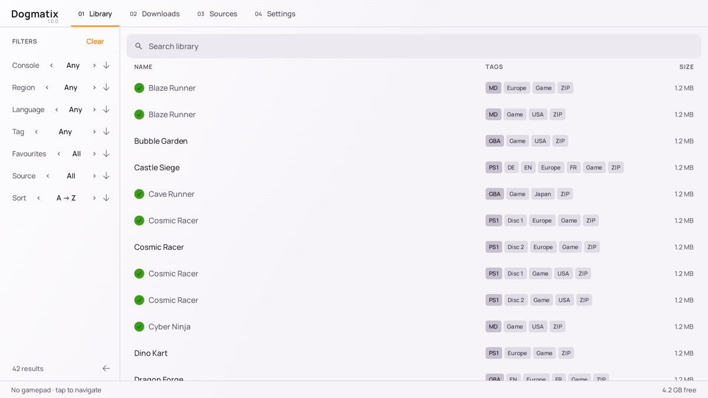
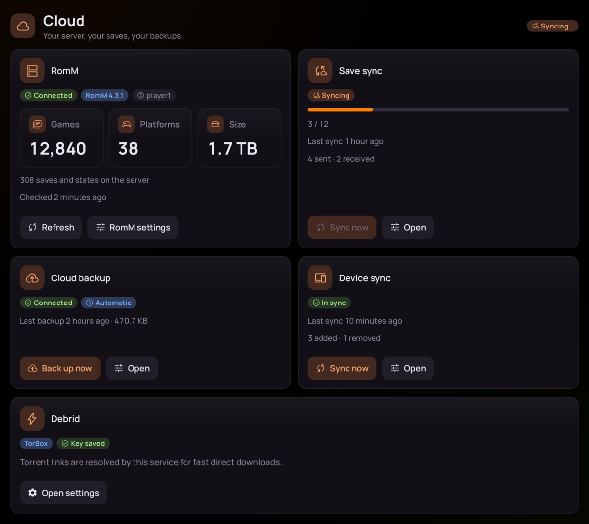

# DogmatixPlus

[English](README.md) · [Nederlands](README.nl.md) · **Français** · [Deutsch](README.de.md) · [Español](README.es.md)

**Trouvez, téléchargez et organisez des jeux rétro sur votre téléphone Android ou votre console portable.**

DogmatixPlus rassemble les jeux des sources que *vous* ajoutez dans une seule grande liste, où l’on peut faire des recherches. Il les télécharge dans les bons dossiers et vous aide à garder votre collection bien rangée. Il fonctionne au toucher *et* avec une manette de jeu. Il est donc à l’aise sur les consoles portables comme les Retroid, Anbernic ou Kinhank.

> **L’application ne contient aucun jeu.** Ajoutez vos sources ou sélectionnez des collections facultatives dans **Sources → Plus de romsets** : homebrews, démos, jeux freeware et logiciels de test proposés par leur éditeur. Vous restez responsable de ce que vous téléchargez.

<table>
  <tr>
    <td align="center" valign="top"> Vos jeux dans une seule liste — un ✓ vert veut dire que vous l’avez déjà</td>
    <td align="center" valign="top"> Trouvez les jeux que vous avez en double</td>
    <td align="center" valign="top"> Voyez votre collection console par console</td>
    <td align="center" valign="top"> Voyez où en est un scan</td>
  </tr>
  <tr>
    <td align="center" valign="top"> Vous voyez toujours quels fichiers vont disparaître</td>
    <td align="center" valign="top"> Les nouveaux outils sont dans les Paramètres</td>
    <td align="center" valign="top"> Les crédits de toutes les personnes impliquées</td>
    <td></td>
  </tr>
</table>

 La nouvelle vue d'ensemble du cloud (titres et chiffres inventés)

*Les captures d’écran utilisent des titres de jeux inventés et des fichiers vides de substitution, et montrent l’application en anglais.*

**Dernière version : [3.3.0](https://github.com/Tufein/DogmatixPlus/releases/tag/v3.3.0)** (build Android 45).

## Installation

1. Ouvrez la **[page Releases](https://github.com/Tufein/DogmatixPlus/releases)** sur votre téléphone ou votre console portable, ou téléchargez-y le fichier et copiez-le sur l’appareil.
2. Téléchargez l’un des deux fichiers :
   - **`DogmatixPlus-release.apk`** — *le choix normal.* Les versions signées actuelles mettent à jour Dogmatix+ en conservant les données. Son paquet est distinct de celui du Dogmatix d’origine.
   - **`DogmatixPlus-debug.apk`** — une application de test séparée avec ses propres données, pour essayer des choses à côté de votre application habituelle.
   - **Vous venez du Dogmatix d’origine ou d’une autre version ?** Faites d’abord une sauvegarde de l’application et restaurez-la dans Dogmatix+. Gardez des copies séparées de vos jeux et sauvegardes, et sélectionnez de nouveau le stockage après la réinstallation.
3. Ouvrez le fichier et autorisez **« Installer des applications inconnues »** si Android vous le demande.

Il vous faut **Android 10 ou plus récent**. L’application n’est pas sur Google Play.

## Premier démarrage

1. Le guide de bienvenue explique les bases.
2. **Choisissez votre dossier de ROM** — le dossier où vos jeux doivent aller.
3. **Importez vos sources** (un fichier avec vos listes de jeux) — ou passez cette étape et ajoutez des sources plus tard dans l’onglet **Sources**.
4. Ouvrez la **Bibliothèque** et touchez un jeu (ou appuyez sur **A**) pour ouvrir sa page. Choisissez ensuite **Télécharger** ou **Jouer**.

## Que peut faire l’application ?

### Trouver des jeux
- **Une seule liste** avec les jeux de toutes vos sources : répertoires web, liens directs, torrents et liens magnet, et votre serveur RomM.
- **Une recherche qui pardonne les fautes** (accents, tirets, lettres doublées), avec les recherches récentes, **Surprenez-moi** et **Plus comme celui-ci**. **Tout rechercher** trouve aussi les réglages, outils et écrans.
- **Filtrer** par console, région, langue, type, genre, décennie et *Nouveau* ; **trier** par nom, taille ou plus récent. Un **✓** vert marque ce que vous avez déjà.
- **Une page par jeu** : visuel, Télécharger ou Jouer, la meilleure version, favori, collections, partage, notes, captures et manuels, et un onglet *Versions* qui explique comment chaque version est notée.
- **À suivre et Pour vous** : une liste de jeux personnelle par profil, et des suggestions tirées de votre propre bibliothèque qui disent toujours pourquoi elles ont été choisies.
- **Collections et objectifs** : favoris, listes personnelles, collections par règles (console, langue, genre, année, joué), objectifs de collection, historique de jeu, bilan annuel et meilleurs jeux par console selon RetroAchievements.
- **Liste de souhaits** : notez les jeux voulus, soyez prévenu quand l’un apparaît, téléchargez-les automatiquement et partagez la liste.
- **Importer une liste** : collez ou chargez un fichier texte ; les jeux trouvés sont téléchargés, les autres vont dans la liste de souhaits.

### Télécharger
- **Liens directs, torrents et liens magnet**, plus **TorBox** et **Real-Debrid** en option.
- **Plusieurs téléchargements à la fois**, avec pause, reprise, nouvel essai, une limite de débit globale (sans limite la nuit si vous le voulez) et une limite par serveur.
- **Les téléchargements interrompus reprennent** là où ils se sont arrêtés, et la file survit à un redémarrage.
- **Télécharger quand cela convient** : seulement en Wi-Fi, pendant la charge, cette nuit ou à une heure fixée. Les téléchargements s’arrêtent si la batterie est faible ou l’appareil chaud, et disent ce qu’ils attendent.
- **Nouvel essai automatique** avec compte à rebours visible, causes d’erreur claires, bascule vers une autre source et historique de fiabilité par source.
- **Meilleure version** choisit votre région et votre langue et écarte les démos ; **Tout télécharger** vérifie d’abord la place.
- **Vérifications** : tailles de fichiers, sommes de contrôle face à la source et décompression sûre des ZIP et 7z (rien n’est écrit hors de son dossier).
- **Partout** : boutons de notification (pause, reprise, arrêt), une tuile des réglages rapides, un widget d’écran d’accueil et une vue pour le second écran.

### Jouer
- **Jouer depuis la page du jeu** avec un émulateur compatible, mémorisé par console ou choisi par jeu, avec une **vérification de préparation** (fichiers, disques, BIOS, émulateur), une configuration guidée et un lancement d’essai.
- **ES-DE, iiSU, Daijishō et Pegasus** : une entrée « chercher d’autres jeux » par console, plus jaquettes et descriptions dans votre lanceur ; pour iiSU, Daijishō et tout autre lanceur, les jaquettes vont dans un dossier de médias que vous choisissez, avec la structure de fichiers attendue par le lanceur (dix structures prêtes à l’emploi, ou écrivez la vôtre).
- **Continuer sur une autre console portable** depuis la page du jeu, quand votre émulateur et vos sauvegardes peuvent suivre : le chemin du retour est montré d’abord et la sauvegarde passe par RomM.
- **Les jeux à plusieurs disques** reçoivent automatiquement leur playlist `.m3u`.
- **Reprendre** sur l’accueil, depuis les sauvegardes de n’importe quel appareil ou depuis ES-DE.

### Garder la bibliothèque en bonne santé
- **Réparer la bibliothèque** : trouve les fichiers vides ou tronqués, les jeux multi-disques avec pistes manquantes, les playlists mortes ou en double, les restes de téléchargements et les repères périmés. Chaque correction est prévisualisée et ce qui est retiré va dans la corbeille avec récupération.
- **Jeux en double** avec un nettoyage sûr et prévisualisé ; **Meilleures versions** et **Libérer de la place**.
- **Vérification DAT** contre No-Intro, Redump et TOSEC ; contrôle des **jeux multi-fichiers** ; **contrôle du BIOS** ; **mises à jour et DLC Switch**.
- **Aperçu de la bibliothèque, Stockage et Statistiques** par console ; le **stockage intelligent** peut déplacer les consoles rarement jouées vers une carte SD et les rapatrier.
- **Explorateur de fichiers** pour regarder, renommer, déplacer et décompresser ; **export** de la collection en CSV ou page web.
- **Copier ou envoyer des jeux** : des jeux complets, avec tous leurs fichiers, vers une carte SD ou un dossier USB, votre serveur RomM ou votre NAS. Vous voyez d’abord chaque fichier, l’espace nécessaire et ce qui s’y trouve déjà ; chaque fichier est vérifié à l’arrivée, les sauvegardes restent sur l’appareil et rien n’est remplacé.
- **Contrôle de santé** avec une solution par problème, et **rapport d’analyse** pour les sources en échec.
- **Sources** : ajout manuel, import et export, partage par codes QR, catalogue de contenus optionnel avec du contenu Libretro pour 29 systèmes et les jeux d’aventure freeware de ScummVM, chacun avec son fournisseur, adresses de secours et analyses automatiques en arrière-plan qui sautent ce qui n’a pas changé.

### Sûr par conception
- **Corbeille et centre de récupération** : jeux retirés, déplacements interrompus, fichiers remplacés et sauvegardes se restaurent, chacun avec un aperçu. Les copies sont vérifiées avant tout retrait.
- **Historique des actions** avec annulation, et un journal qui survit à un plantage.
- **Les mises à jour depuis l’application** sont vérifiées (somme de contrôle, paquet, version, signataire) avant l’installation par Android.
- **Signaler un problème** crée un rapport privé et modifiable dont vous choisissez le contenu ; chemins, adresses de serveur, clés et jetons sont retirés et l’application n’envoie rien.

### Cloud et synchronisation
- **RomM** : envoyer les téléchargements terminés et des jeux complets en plusieurs fichiers, l’utiliser comme source, voir jeux, genres et captures, synchroniser statut de jeu, note et favoris, récupérer les BIOS manquants.
- **Synchro des sauvegardes et sauvegardes cloud** : vos sauvegardes voyagent entre consoles et RomM, y compris les cartes mémoire DuckStation, les dossiers de sauvegarde PPSSPP et, si vous le choisissez, des cartes entières Dolphin et NetherSX2 ; en cas de conflit on vous demande, et les copies remplacées sont gardées 30 jours.
- **Votre propre cloud (WebDAV)** : sauvegardes chiffrées (Nextcloud, ownCloud, Synology et autres) et synchro d’appareils pour favoris, liste de souhaits et collections.
- **RetroAchievements** : progression et badges par jeu, votre profil et les jeux qui ont des succès.

### Profils
- **Les profils** masquent des consoles ou des jeux portant certaines étiquettes (un profil enfant), avec un code PIN facultatif. Favoris, émulateurs, notes et À suivre sont gardés par profil.

### Pensé pour les consoles portables
- **Tout se fait à la manette** (croix directionnelle, A/B/X/Y, gâchettes) ; les indications à l’écran suivent Xbox, Nintendo ou PlayStation. Maintenez **SELECT** pour un menu rapide.
- **Paysage et portrait**, une vue **second écran** et un **mode TV** avec texte plus grand et touches de télécommande.
- **Thème clair, sombre ou noir pur**, douze couleurs d’accent et Material You, jaquettes, taille de texte réglable et animations désactivables.
- **Sept langues** : anglais, néerlandais, allemand, français, espagnol, italien et portugais.
- **Sauvegarde et restauration** des réglages, sources, favoris, collections et liste de téléchargements dans un seul fichier.

## Utiliser une manette

| Bouton | Ce qu’il fait |
|---|---|
| D-pad | Se déplacer |
| **A** | Choisir / ouvrir la page du jeu ; télécharger ou jouer depuis cette page |
| **B** | Revenir en arrière d’une étape |
| **X** | Infos du jeu |
| **Y** | Rechercher |
| **Select** | Ajouter un jeu aux favoris ou l’en retirer |
| **LB / RB** | Passer des filtres à la liste, et inversement |
| **ZL / ZR** | Section précédente / suivante |
| **R3** | Masquer ou afficher le panneau de filtres |

Tout fonctionne aussi au toucher. Les indications ne s’affichent que lorsqu’une manette est connectée.

## Bon à savoir

- Les jeux retirés vont dans la corbeille. Restaurez ou videz via Outils → Corbeille et récupération. L’espace est libéré après vidage. L’explorateur utilise aussi la récupération par défaut ; la suppression définitive doit être choisie dans la confirmation.
- **Un fichier de sauvegarde contient vos clés de compte** (TorBox, Real-Debrid, RomM). Gardez-le privé.
- **La fenêtre d’infos du jeu reste vide dans les fichiers proposés au téléchargement ici**, car elle a besoin d’une clé gratuite, fournie par une base de données de jeux et ajoutée lors de la compilation de l’application.
- DogmatixPlus ne cherche pas de jeux tout seul. Il lit seulement les sources que **vous** ajoutez.
- **Quelque chose ne marche pas ?** *Réglages → Application et mises à jour → Signaler un problème* crée un rapport privé à coller dans un ticket GitHub ; chemins, adresses de serveur, clés et jetons sont retirés d’abord.

## Pour les développeurs et utilisateurs avancés

- **[TECHNICAL.md](TECHNICAL.md)** : construction de l’application, décisions de la recherche de doublons, organisation des dossiers, liens profonds et technologies (en anglais).
- **[FRONTENDS.md](FRONTENDS.md)** : configurer ES-DE, iiSU, Daijishō et Pegasus.
- **[Feuille de route](docs/ROADMAP.md)** : idées pour les prochaines versions.
- **[Versions](https://github.com/Tufein/DogmatixPlus/releases)** : téléchargements et sommes de contrôle.

## Crédits

DogmatixPlus est une petite couche ajoutée par-dessus deux autres projets. La plus grande partie de ce que vous utilisez tous les jours vient d’eux.

| Projet | Réalisé par | Ce qu’il a apporté |
|---|---|---|
| **[Milou](https://github.com/santiifm/milou)** | [santiifm](https://github.com/santiifm) | L’application d’origine et tout son moteur : lecture des sources, classement des jeux par console / région / langue, recherche, téléchargement et décompression. |
| **[Dogmatix](https://github.com/cortinadev/dogmatix)** | [Rafa Cortina](https://github.com/cortinadev) | La version pour consoles portables : contrôle à la manette, affichage paysage, thèmes, favoris, pause et reprise, le guide de premier démarrage, ES-DE / iiSU / Daijishō, TorBox et Real-Debrid, RomM. |
| **DogmatixPlus** | [Tufein](https://github.com/Tufein) | Recherche de doublons, aperçu de la bibliothèque, sauvegarde et restauration, progression du scan, synchro des sauvegardes avec RomM, vérification des jeux multi-fichiers, aperçu du stockage, liste de souhaits, export, planification des téléchargements, vérification des sommes de contrôle, traductions en néerlandais, français, allemand, italien et portugais, et ces versions. |

DogmatixPlus a été **réalisé avec l’aide de l’IA** : le code, les tests et la documentation ont été écrits avec un assistant IA et vérifiés lors de plusieurs tours de relecture. Les décisions, l’orientation et la publication reviennent à la personne qui s’occupe du projet.

## Avertissement

Cette application est uniquement destinée à un usage éducatif. Il vous incombe de vous assurer que vous avez le droit légal de télécharger tout contenu.

Milou et Dogmatix n’ont pas de licence, donc tous les droits sur leur code restent à leurs auteurs. DogmatixPlus est une modification personnelle non officielle et n’est affilié à aucun des deux projets. Si vous êtes l’un des auteurs d’origine et que vous souhaitez que quelque chose soit modifié ou retiré, merci d’ouvrir une issue.
