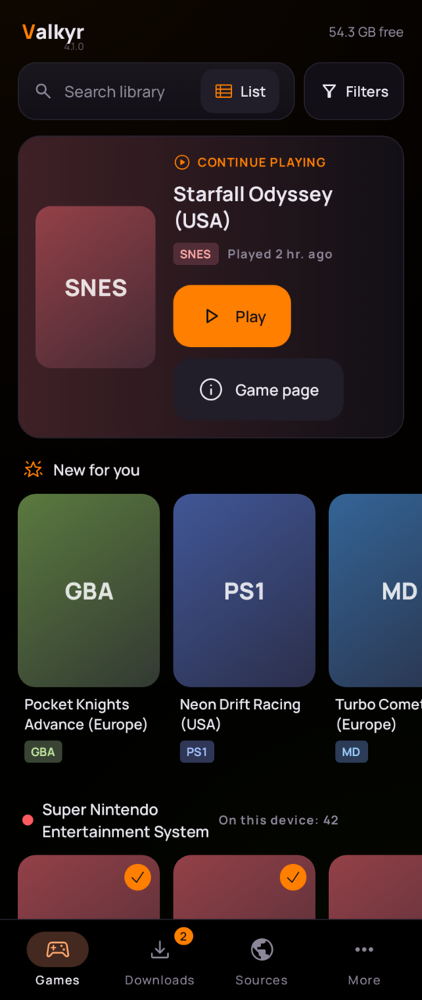
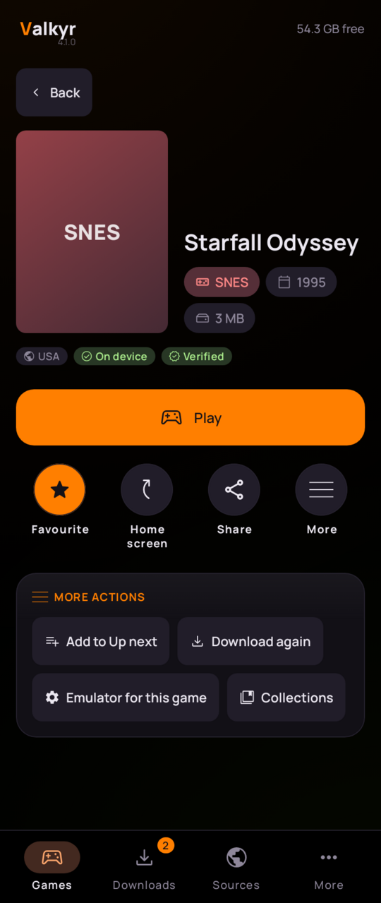
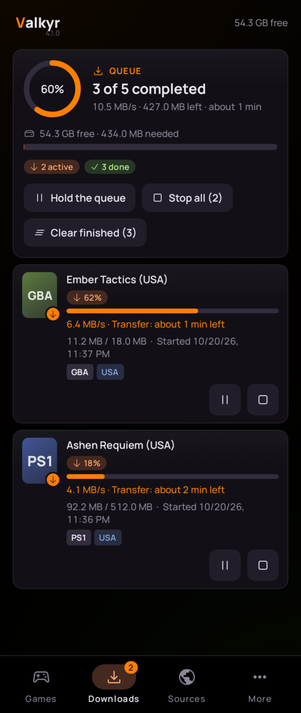
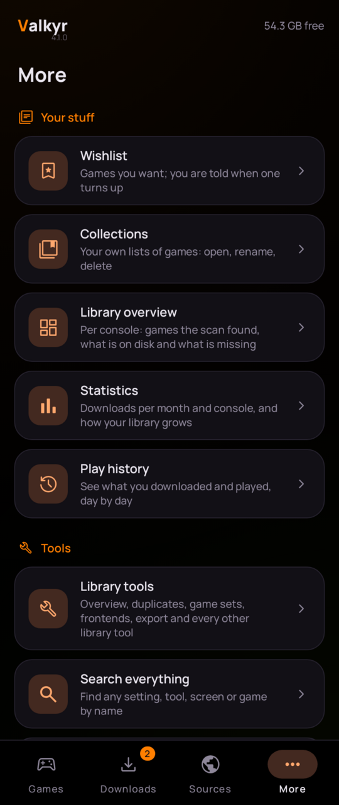
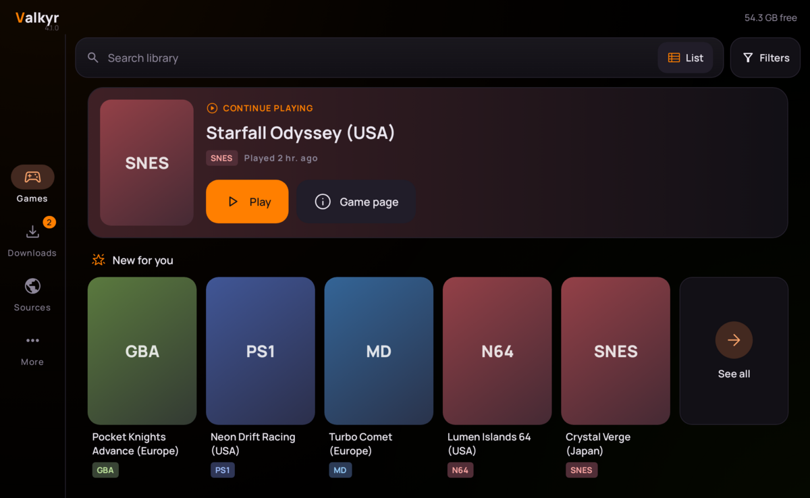

# Valkyr

[English](README.md) · **Nederlands** · [Français](README.fr.md) · [Deutsch](README.de.md) · [Español](README.es.md)

**Vind, download en organiseer retrogames op je Android-telefoon of handheld.**

Valkyr houdt één grote, doorzoekbare lijst bij van de games uit de bronnen die *jij* toevoegt, downloadt ze in de juiste mappen en helpt je om je collectie netjes te houden. Het werkt met het touchscreen *en* met een gamecontroller, dus het is ook op handhelds zoals de Retroid, Anbernic of Kinhank helemaal op zijn plek.

> **De app bevat geen games.** Voeg je eigen bronnen toe of kies optionele collecties via **Bronnen → Meer romsets**. Die catalogus verwijst naar door de uitgever aangeboden homebrew, demo’s, freeware-games en testsoftware. Je blijft zelf verantwoordelijk voor wat je downloadt.

<table>
  <tr>
    <td align="center" valign="top"> Start: speel verder waar je gebleven was, met een plank hoesjes per console</td>
    <td align="center" valign="top"> Elke game heeft een eigen pagina met een grote Spelen-knop</td>
    <td align="center" valign="top"> Volg je downloads en de hele wachtrij</td>
    <td align="center" valign="top"> Al het andere zit onder Meer, één tik verderop</td>
  </tr>
</table>

 Op een handheld in liggende stand staan de onderdelen in een balk links

 Het cloud-overzicht: RomM, savesynchronisatie en back-ups in één oogopslag (namen en cijfers zijn verzonnen)

*De screenshots gebruiken verzonnen gametitels en lege dummybestanden en tonen de app in het Engels.*

**Laatste release: [4.4.0](https://github.com/Tufein/Valkyr/releases/tag/v4.4.0)** (Android build 56).

Tot en met 3.9.0 heette de app Dogmatix+. Valkyr 4.4.0 heeft een eigen app-id en installeert dus naast de oude app: gebruik *Instellingen → Back-up maken* in de oude app en *Back-up terugzetten* in Valkyr, en verwijder daarna de oude app.

## Installeren

1. Open de **[Releases-pagina](https://github.com/Tufein/Valkyr/releases)** op je telefoon of handheld, of download het bestand daar en kopieer het naar je toestel.
2. Download een van de twee bestanden:
   - **`Valkyr-release.apk`** — *de gewone keuze.* Ondertekende releases werken de app bij en behouden je gegevens.
   - **`Valkyr-debug.apk`** — een aparte testapp met eigen gegevens, om dingen uit te proberen naast je gewone app.
3. Open het bestand en sta **"Onbekende apps installeren"** toe als Android erom vraagt.

Je hebt **Android 10 of nieuwer** nodig. De app staat niet in Google Play.

## Eerste start

1. De welkomstgids legt de basis uit.
2. **Kies je ROM-map** — de map waar je games in moeten komen.
3. **Importeer je bronnen** (een bestand met je gamelijsten) — of sla dit over en voeg later bronnen toe in het tabblad **Bronnen**.
4. Open de **Bibliotheek**, zoek een game en tik erop (of druk op **A**) om de gamepagina te openen. Kies daar **Downloaden** of **Spelen**.

## Wat kan het?

### Games vinden
- **Eén lijst** met de games van al je bronnen: webmappen, directe links, torrents en magnetlinks, en je RomM-server.
- **Zoeken dat fouten vergeeft** (accenten, streepjes, dubbele letters), met recente zoekopdrachten, **Verras me** en **Meer zoals dit**. **Alles doorzoeken** vindt ook instellingen, hulpmiddelen en schermen.
- **Filter** op console, regio, taal, type, genre, decennium en *Nieuw*; **sorteer** op naam, grootte of nieuwste. Een groen **✓** toont wat je al hebt.
- **Een pagina voor elke game**: afbeelding, Downloaden of Spelen, de beste versie, favoriet, collecties, delen, notities, schermafbeeldingen en handleidingen, en een tabblad *Versies* dat uitlegt hoe elke versie scoort.
- **Covers eerst**: Home opent met planken vol grote covers (verder spelen, nieuw voor jou, een plank per console); de navigatie zit in een balk onderaan, of een smalle zijbalk op een handheld, met Games, Downloads, Bronnen en Meer. De spelpagina begint met een grote cover en één grote knop Spelen of Download.
- **Covers uit meerdere bronnen**: RomM, libretro-thumbnails, [ScreenScraper](https://www.screenscraper.fr) (met je eigen inlog), TheGamesDB, SteamGridDB en IGDB (elk met je eigen gratis sleutel) en de opgeslagen spelafbeeldingen, in een volgorde die jij kiest. De app meldt duidelijk als een login mislukt of een daglimiet is bereikt, en een bron die alleen even niet beschikbaar was, wordt later opnieuw gevraagd (*Instellingen → Coverbronnen*).
- **Hierna spelen en Voor jou**: een persoonlijke speellijst per profiel, en suggesties uit je eigen bibliotheek die altijd zeggen waarom ze zijn gekozen.
- **Collecties en doelen**: favorieten, eigen lijsten, collecties op basis van regels (console, taal, genre, jaar, gespeeld), collectiedoelen, speelgeschiedenis, een jaaroverzicht en de beste games per console van RetroAchievements.
- **Verlanglijst**: noteer games die je wilt, krijg een melding als er een opduikt, download ze automatisch en deel de lijst.
- **Lijst importeren**: plak of laad een tekstbestand; gevonden games worden gedownload, de rest gaat naar de verlanglijst.

### Downloaden
- **Directe links, torrents en magnetlinks**, plus optioneel **TorBox** en **Real-Debrid**.
- **Meerdere downloads tegelijk**, met pauzeren, hervatten, opnieuw proberen, een globale snelheidslimiet (desgewenst geen limiet 's nachts) en een limiet per server.
- **Totale voortgangscirkel** telt voltooide downloads op tegenover de hele wachtrij: 25 van 100 = 25%. Alleen volledig afgeronde downloads tellen mee, zodat de cirkel blijft oplopen als er een klaar is.
- **Onderbroken downloads gaan verder** waar ze stopten, en de wachtrij overleeft een herstart of reboot.
- **Downloaden wanneer het uitkomt**: alleen op wifi, tijdens het opladen, vannacht of op een ingesteld tijdstip. Downloads pauzeren bij een lage batterij of een warm toestel en zeggen waarop ze wachten.
- **Automatisch opnieuw proberen** met zichtbare aftelling, duidelijke foutredenen, overstap naar een andere bron en een staat van dienst per bron.
- **Beste versie** kiest jouw regio en taal en slaat demo's over; **Alles tonen downloaden** controleert eerst de ruimte.
- **Controles**: bestandsgroottes, controlesommen tegen de bron en veilig uitpakken van ZIP en 7z (niets wordt buiten de eigen map geschreven).
- **Overal**: meldingsknoppen (pauzeren, hervatten, stoppen), een tegel voor Snelle instellingen, een widget op het startscherm en een weergave voor het tweede scherm.

### Spelen
- **Spelen vanaf de gamepagina** met een geschikte emulator, onthouden per console of per game gekozen, met een **gereedheidscontrole** (bestanden, discs, BIOS, emulator), een begeleide installatie en een testlancering.
- **ES-DE, iiSU, Daijishō en Pegasus**: een invoer "zoek meer games" per console, plus covers en beschrijvingen in je launcher; voor iiSU, Daijishō en elke andere launcher komen de covers in een mediamap die je zelf kiest, in de bestandsindeling die die launcher verwacht (tien kant-en-klare indelingen, of schrijf er zelf een).
- **Games op je startscherm**: zet een game vast vanaf zijn pagina en hij start meteen in zijn emulator; lang drukken op het app-icoon toont ook je laatste drie gespeelde games.
- **RetroArch-playlists**: schrijft `.lpl`-afspeellijsten zodat RetroArch je bibliotheek toont; bestaande playlists worden alleen aangevuld en het oude bestand gaat eerst naar Prullenbak en herstelcentrum.
- **Verder spelen op een andere handheld** vanaf de spelpagina, als je emulator en saves mee kunnen: je ziet eerst de weg terug en de save gaat via RomM.
- **Games met meerdere discs** krijgen automatisch hun `.m3u`-afspeellijst.
- **Verder spelen** op Home, vanuit saves op elk toestel of vanuit ES-DE.

### Je bibliotheek gezond houden
- **Bibliotheek herstellen**: vindt lege of afgebroken bestanden, discsets met ontbrekende tracks, dode of dubbele afspeellijsten, resten van downloads en verouderde bibliotheekmarkeringen. Elke oplossing krijgt eerst een voorbeeld en wat verdwijnt gaat naar Prullenbak en herstel.
- **Dubbele games** met een veilige opruiming met voorbeeld; **Betere versies** en **Ruimte vrijmaken**.
- **DAT-controle** tegen No-Intro, Redump en TOSEC; controle van **gamesets**; **BIOS-controle**; **Switch-updates en DLC**.
- **Bibliotheekoverzicht, Opslag en Statistieken** per console; **Slimme opslag** kan zelden gespeelde consoles naar een SD-kaart verplaatsen en terug.
- **Bestandsverkenner** om te kijken, hernoemen, verplaatsen en uitpakken; **exporteer** je collectie als CSV of webpagina.
- **Spellen kopiëren of versturen**: complete spellen met alle bestanden naar een SD-kaart of USB-map, je RomM-server of je NAS. Je ziet eerst elk bestand, de benodigde ruimte en wat er al staat; elk bestand wordt aan de andere kant gecontroleerd, savebestanden blijven achter en er wordt niets vervangen. Voor een kaart die in een ander systeem gaat, kunnen de consolemappen de namen van ES-DE, Batocera, Knulli, ArkOS, ROCKNIX, OnionOS of muOS volgen.
- **Gezondheidscontrole** met een oplossing per probleem, en een **scanrapport** voor bronnen die mislukten.
- **Bronnen**: met de hand toevoegen, importeren en exporteren, delen als QR-codes, optionele inhoudscatalogus met Libretro-content voor 29 systemen, de freeware-avonturenspellen van ScummVM en gratis Game Boy-homebrew van Homebrew Hub, steeds met de aanbieder erbij, reserveadressen en automatische achtergrondscans die overslaan wat niet veranderde.

### Veilig ontworpen
- **Prullenbak en herstelcentrum**: verwijderde games, onderbroken verplaatsingen, vervangen bestanden en savebackups zijn te herstellen, telkens met een voorbeeld. Kopieën worden gecontroleerd voordat iets wordt verwijderd.
- **Actiegeschiedenis** met ongedaan maken, en een logboek dat een crash overleeft.
- **Updates vanuit de app** worden op controlesom, pakket, versie en ondertekenaar gecontroleerd voordat Android ze installeert.
- **Probleem melden** maakt een privé, bewerkbaar rapport waarvan jij kiest wat erin komt; paden, serveradressen, sleutels en tokens worden verwijderd en de app verstuurt niets.

### Cloud en synchronisatie
- **RomM**: verstuur voltooide downloads en complete spellen met meerdere bestanden, gebruik het als bron, zie games, genres en schermafbeeldingen, synchroniseer speelstatus, beoordeling en favorieten, haal ontbrekende BIOS-bestanden op.
- **Savesynchronisatie en cloudsaves**: je saves en savestates reizen tussen handhelds en RomM, ook DuckStation-geheugenkaarten, PPSSPP-savemappen en, als je dat kiest, hele Dolphin- en NetherSX2-geheugenkaarten, Dolphin-GameCube-savemappen en Wii-saves; bij conflicten word je gevraagd en vervangen kopieën blijven 30 dagen bewaard.
- **Je eigen cloud (WebDAV)**: versleutelde back-ups (Nextcloud, ownCloud, Synology en andere) en toestelsynchronisatie van favorieten, verlanglijst en collecties.
- **RetroAchievements**: voortgang en badges per game, je profiel, en welke games achievements hebben.

### Profielen
- **Profielen** verbergen consoles of games met gekozen tags (een kinderprofiel), met een optionele pincode. Favorieten, emulators, notities en Hierna spelen worden per profiel bewaard.

### Gemaakt voor handhelds
- **Alles werkt met een gamepad** (D-pad, A/B/X/Y, schouderknoppen); de hints op het scherm passen bij Xbox, Nintendo of PlayStation. Houd **SELECT** ingedrukt voor een snelmenu.
- **Liggend en staand**, een weergave voor het **tweede scherm** en een **tv-modus** met grotere tekst en afstandsbedieningstoetsen.
- **Licht, donker of zuiver zwart** thema, twaalf accentkleuren en Material You, covers, instelbare tekstgrootte en animaties die uit kunnen.
- **Zeven talen**: Engels, Nederlands, Duits, Frans, Spaans, Italiaans en Portugees.
- **Een nieuwe handheld instellen**: een checklist van verse installatie tot klaar voor gebruik (instellingen, gamesmap, emulators, ontbrekende games, saves, launcher); elke stap opent het scherm dat het doet.
- **Back-up en herstel** van instellingen, bronnen, favorieten, collecties en de downloadlijst in één bestand.

## Een gamepad gebruiken

| Knop | Wat doet hij? |
|---|---|
| D-pad | Navigeren |
| **A** | Kiezen / gamepagina openen; daar downloaden of spelen |
| **B** | Een stap terug |
| **X** | Game-info |
| **Y** | Zoeken |
| **Select** | Een game een ster geven of de ster weghalen |
| **LB / RB** | Wisselen tussen de filters en de lijst |
| **ZL / ZR** | Vorige / volgende sectie |
| **R3** | Het filterpaneel in- of uitklappen |

Alles werkt ook met het touchscreen. De hints verschijnen alleen als er een controller is aangesloten.

## Goed om te weten

- Verwijderde games gaan naar de prullenbak. Herstel of leeg definitief via Hulpmiddelen → Prullenbak en herstel. Ruimte komt vrij na het legen. De bestandsverkenner gebruikt standaard ook herstelbaar verwijderen; definitief verwijderen moet je in de bevestiging kiezen.
- **Een back-upbestand bevat je accountsleutels** (TorBox, Real-Debrid, RomM). Houd het privé.
- **Het venster met game-info blijft leeg in de versies van de app die je hier downloadt**, omdat het een gratis sleutel van een gamedatabase nodig heeft die wordt toegevoegd wanneer de app wordt gebouwd.
- Valkyr zoekt zelf niet naar games. Het leest alleen de bronnen die **jij** toevoegt.
- **Werkt iets niet?** *Instellingen → App en updates → Probleem melden* maakt een privérapport dat je in een GitHub-melding kunt plakken; paden, serveradressen, sleutels en tokens worden eerst verwijderd.

## Voor ontwikkelaars en gevorderden

- **[TECHNICAL.md](TECHNICAL.md)**: hoe de app is gebouwd, hoe de functie Dubbele games beslist, de mappenstructuur, deep links en de gebruikte technologie (in het Engels).
- **[FRONTENDS.md](FRONTENDS.md)**: ES-DE, iiSU, Daijishō en Pegasus instellen.
- **[Roadmap](docs/ROADMAP.md)**: ideeën voor toekomstige versies.
- **[Releases](https://github.com/Tufein/Valkyr/releases)**: downloads en controlesommen.

## Credits

Valkyr wordt gemaakt door [Tufein](https://github.com/Tufein). Het is gebouwd met deze opensourceprojecten en gegevensbronnen:

| Wat | Gebruikt voor |
|---|---|
| [Jetpack Compose / AndroidX](https://developer.android.com/jetpack/androidx), [Kotlin coroutines](https://github.com/Kotlin/kotlinx.coroutines), [Dagger Hilt](https://github.com/google/dagger) | De app zelf (Apache-2.0) |
| [Gson](https://github.com/google/gson), [Coil](https://github.com/coil-kt/coil), [jsoup](https://jsoup.org), [ZXing](https://github.com/zxing/zxing) | JSON, afbeeldingen, webmappen lezen, QR-codes |
| [7-Zip-JBinding](https://github.com/borisbrodski/sevenzipjbinding), [libtorrent4j](https://github.com/aldenml/libtorrent4j) | Archieven uitpakken, torrents |
| [Space Mono](https://fonts.google.com/specimen/Space+Mono), [Manrope](https://fonts.google.com/specimen/Manrope) | Lettertypen (SIL Open Font License) |
| [RetroAchievements](https://retroachievements.org), [RAWG](https://rawg.io), [TheGamesDB](https://thegamesdb.net), [SteamGridDB](https://www.steamgriddb.com), [IGDB](https://www.igdb.com), [ScreenScraper](https://www.screenscraper.fr), [libretro-thumbnails](https://github.com/libretro-thumbnails/libretro-thumbnails) | Achievements, spelinformatie en covers |
| [No-Intro](https://no-intro.org), [Redump](http://redump.org), [TOSEC](https://www.tosecdev.org) | DAT-controles |
| [RomM](https://github.com/rommapp/romm), [ES-DE](https://es-de.org), [Libretro](https://www.libretro.com), [ScummVM](https://www.scummvm.org), [Homebrew Hub](https://hh.gbdev.io) | Server, launcher en gratis content waarmee de app werkt |

## Disclaimer

Deze app is alleen bedoeld voor educatieve doeleinden. Je bent er zelf verantwoordelijk voor dat je het wettelijke recht hebt om welke content dan ook te downloaden.
